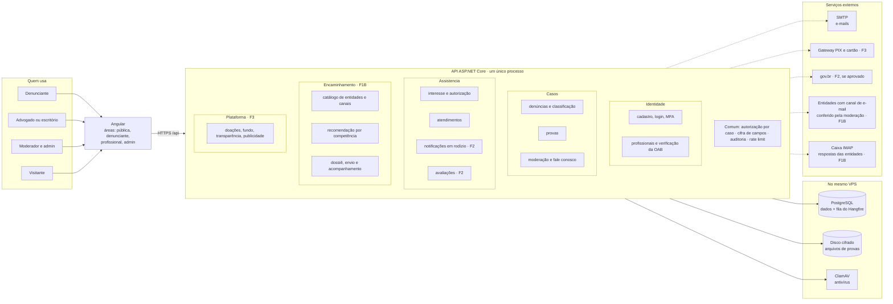
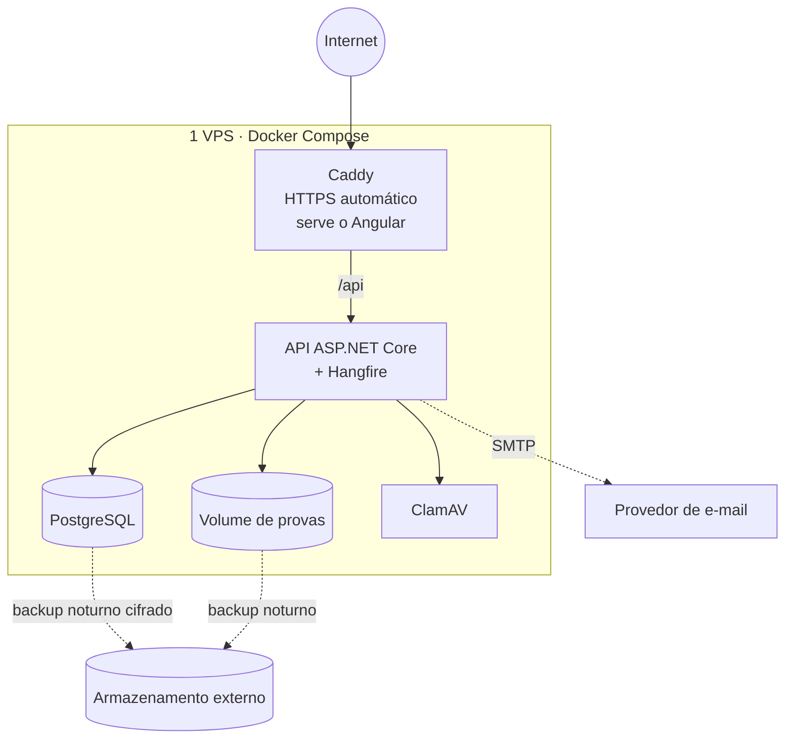

# 1 · Visão geral: módulos e integrações

Monólito modular com um único deploy. O backend tem **3 módulos no MVP** (um projeto C# e um schema do banco cada), um quarto na Fase 1B (Encaminhamento) e um quinto na Fase 3. Os módulos só conversam entre si por interfaces públicas (`Contratos/`), o que permite separá-los no futuro se for preciso.

**Legenda:** sem marcação = MVP (Fase 1). F1B, F2 e F3 = fases seguintes. Linha tracejada = serviço externo.

A verificação da OAB é **manual** no MVP: o admin confere no site do CNA, que não tem API pública (ver [decisões](../decisoes.md), D9).

Formulários oficiais (MTE, MPT, MPF, Fala.BR) não aparecem como integração: o denunciante os preenche no site oficial, com os campos prontos pela plataforma (modo assistido, ver [encaminhamento](06-encaminhamento.md) e D23).

## Implantação

