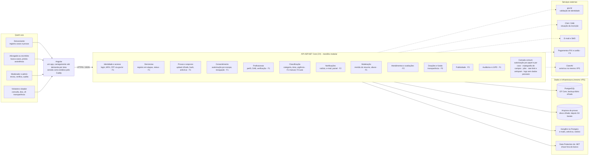
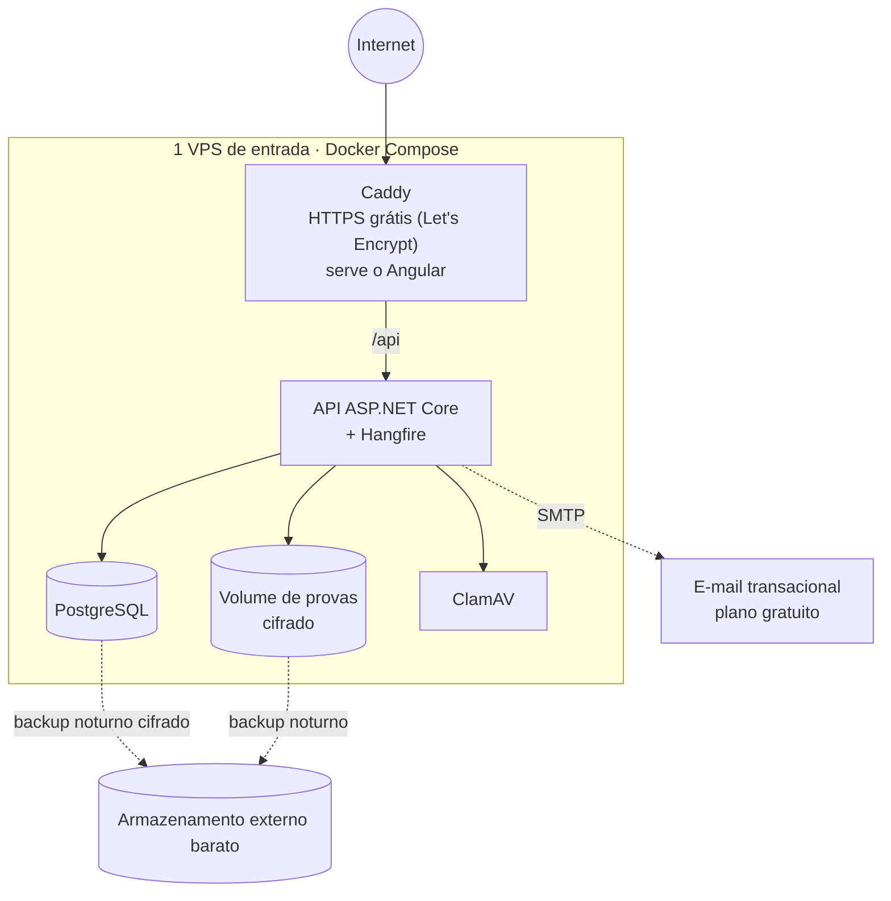

# 1 · Visão geral: módulos e integrações

Monólito modular com um único deploy. Cada módulo tem suas próprias tabelas e serviços e só conversa com os outros por interfaces internas, o que permite separá-los no futuro se for preciso.

**Legenda:** F1, F2, F3 = fase do roadmap (MVP, operação, sustentabilidade). Linha tracejada = integração externa, opcional e substituível.

## Implantação mínima

