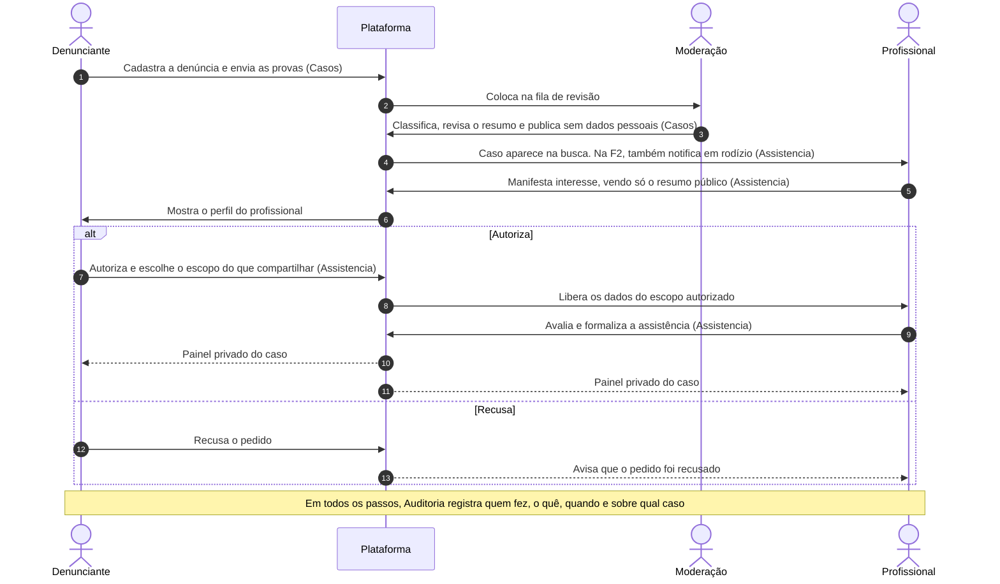

# 2 · Fluxo do caso entre os atores

Os 8 passos do processo de assistência. Entre parênteses, o módulo responsável.

No MVP, a classificação é feita pelo moderador junto com a revisão, e o profissional encontra o caso pela busca. A sugestão automática de classificação e as notificações em rodízio entram na Fase 2.

