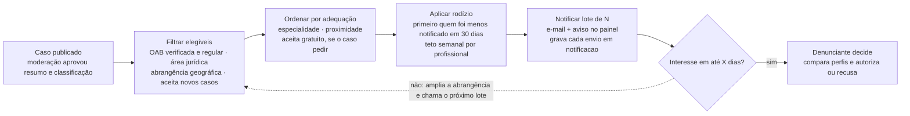

# 3 · Distribuição de notificações em rodízio

Implementado como um job recorrente do Hangfire e uma consulta SQL com filtro e ordenação. Sem serviço de fila nem motor de regras à parte.

> N e X ainda precisam ser definidos.

## Regras

- **Sem leilão nem pagamento por caso.** Ninguém compra prioridade, o que evita captação irregular de clientela (Código de Ética da OAB).
- **A notificação não abre dados privados.** O profissional vê só o resumo público até o denunciante autorizar.
- **Tudo é registrado.** Quem foi notificado, quando e por qual critério, para auditar se o rodízio está equilibrado.
