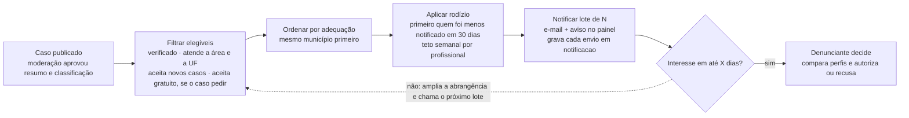

# 3 · Distribuição de notificações em rodízio (Fase 2)

No MVP não há notificação: o profissional encontra o caso pela busca. Na Fase 2, isto vira um job do Hangfire disparado quando o caso é publicado, com uma consulta SQL de filtro e ordenação. Sem serviço de fila nem motor de regras à parte.

Todos os campos usados no filtro são colunas comuns (não cifradas): `profissional.areas`, `ufs_atendidas`, `aceita_novos_casos`, `aceita_gratuito`, `verificado_em` e `denuncia.precisa_gratuito`.

> N e X ainda precisam ser definidos.

## Regras

- **Sem leilão nem pagamento por caso.** Ninguém compra prioridade, o que evita captação irregular de clientela (Código de Ética da OAB).
- **A notificação não abre dados privados.** O profissional vê só o resumo público até o denunciante autorizar.
- **Tudo é registrado.** Quem foi notificado e quando (tabela `notificacao`), para auditar se o rodízio está equilibrado.
