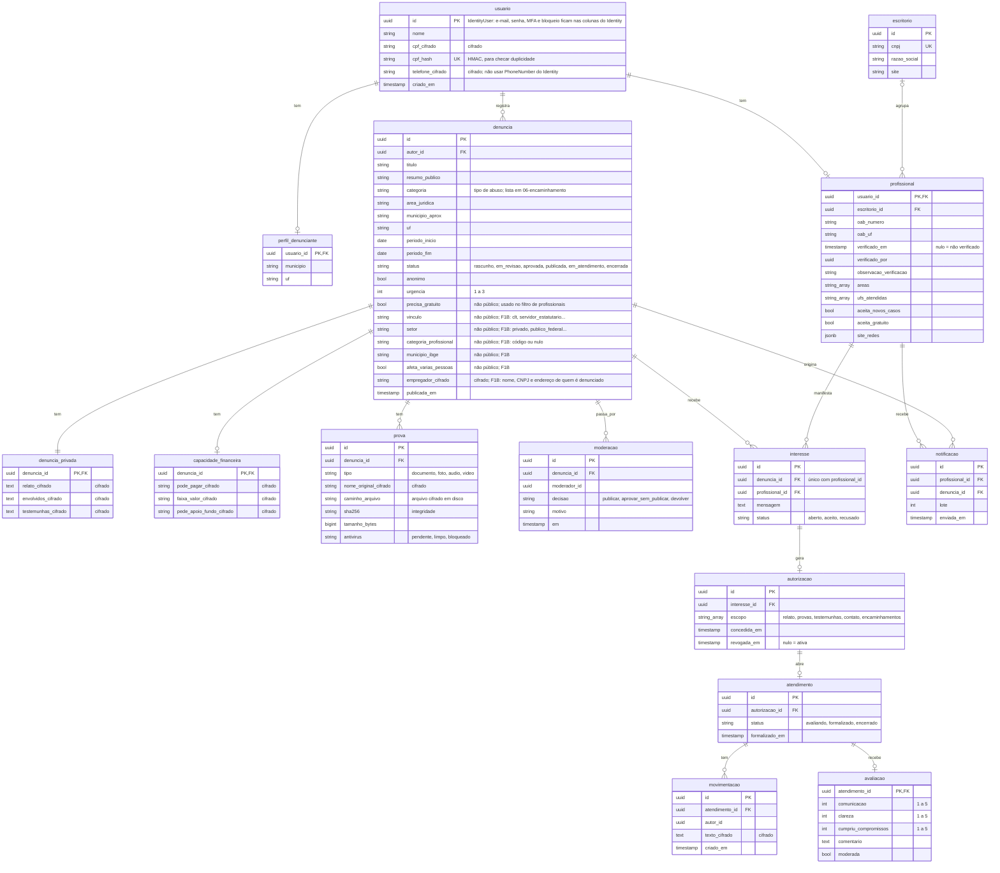
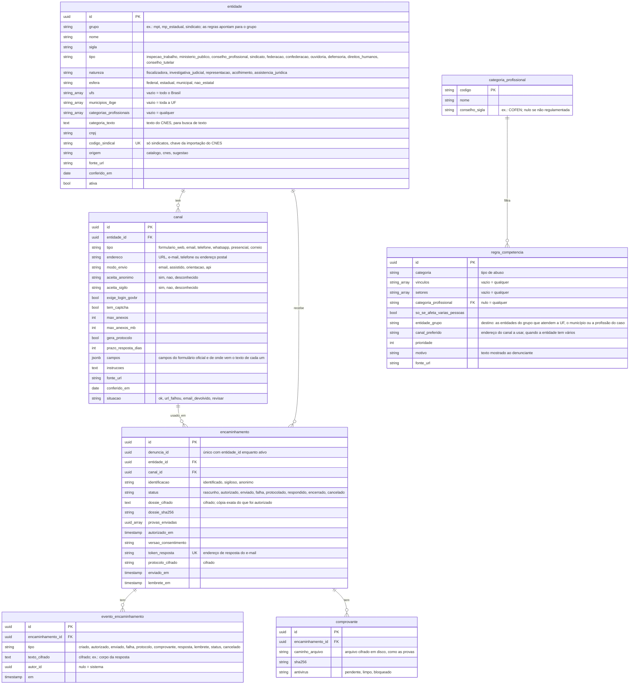

# 4 · Modelo de dados (PostgreSQL + EF Core)

Um schema por módulo, cada um com seu `DbContext`:

| Schema | Dono | Tabelas |
|---|---|---|
| `identidade` | módulo Identidade | tabelas do ASP.NET Core Identity, `perfil_denunciante`, `profissional`, `escritorio` |
| `casos` | módulo Casos | `denuncia`, `denuncia_privada`, `capacidade_financeira`, `prova`, `moderacao`, `manifestacao` |
| `assistencia` | módulo Assistencia | `interesse`, `autorizacao`, `atendimento`, `movimentacao`, `avaliacao`, `notificacao` |
| `encaminhamento` | módulo Encaminhamento (Fase 1B) | `entidade`, `canal`, `regra_competencia`, `categoria_profissional`, `modelo_documento`, `encaminhamento`, `evento_encaminhamento`, `comprovante` |
| `auditoria` | Comum | `registro_auditoria` |
| `plataforma` | módulo Plataforma (Fase 3) | `doacao`, `lancamento`, `apoio_fundo` |

Campos com "cifrado" são criptografados na aplicação e ficam ilegíveis para quem acessar o banco ou um backup. Por isso **não dá para filtrar nem ordenar por eles em SQL**: tudo que precisa entrar num `WHERE` fica em coluna comum.

`aprovada` = revisada pela moderação e liberada para encaminhamento automático, sem resumo público. Serve para quem quer encaminhar o caso a órgãos sem publicá-lo.

## Schema `encaminhamento` (Fase 1B)

Detalhes de uso em [encaminhamento](06-encaminhamento.md). O catálogo (`entidade`, `canal`, `regra_competencia`, `categoria_profissional`) é público e não tem dados pessoais. `denuncia_id` é referência a outro schema, sem chave estrangeira.

`modelo_documento` (fora do diagrama): `tipo_entidade`, `cabecalho`, `pedido`, `versao`. Um modelo por tipo de entidade, editável pela moderação.

Tabelas fora do diagrama:

- **`casos.manifestacao`** (fale conosco, pedidos e reportes): `id`, `tipo` (`duvida`, `sugestao`, `reclamacao`, `incluir_entidade`, `incluir_categoria`, `corrigir_catalogo`, `conteudo_abusivo`), `autor_id` (nulo = visitante), `denuncia_id` (nulo, ou o caso reportado, ou um caso do próprio autor), `entidade_id` (nulo, ou a entidade a corrigir), `dados_pedido jsonb` (nome, UF e site oficial da entidade pedida; nada pessoal), `texto_cifrado` (cifrado), `email_resposta_cifrado` (cifrado, opcional), `status` (`aberta`, `em_analise`, `respondida`, `aceita`, `recusada`), `resposta_cifrado` (cifrado), `tratada_por`, `criado_em`, `respondida_em`.
- **`auditoria.registro_auditoria`**: `id bigserial`, `ator_id uuid`, `acao`, `recurso`, `recurso_id`, `em`. Um trigger no banco recusa UPDATE e DELETE. Guarda só IDs, nunca dados pessoais.
- **Fase 3, schema `plataforma`**: `doacao` (valor, meio, id no gateway, data), `lancamento` (tipo receita/despesa/fundo, categoria, valor, data, comprovante) e `apoio_fundo` (denuncia_id, valor aprovado, critério, data da decisão).

Referências entre schemas (ex.: `denuncia.autor_id` → usuário) são só IDs, sem chave estrangeira no banco: cada módulo é dono das suas tabelas.
