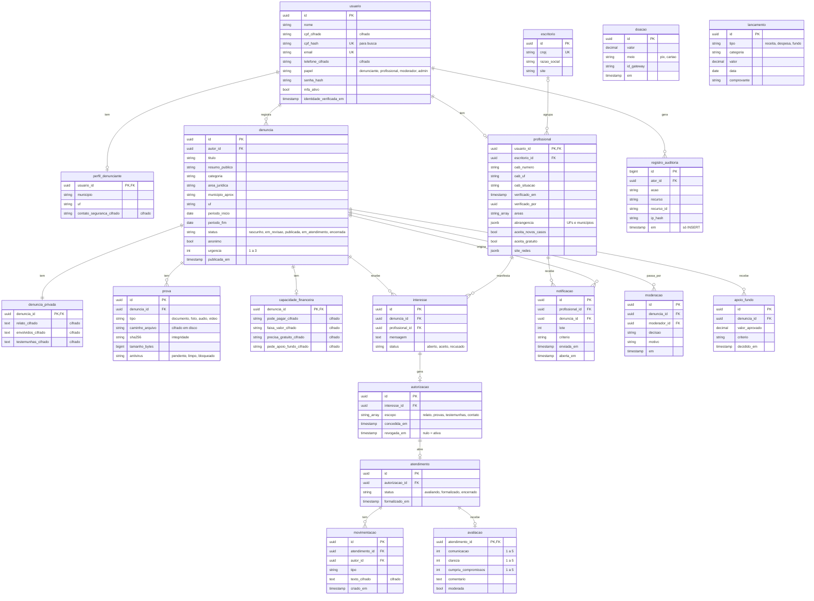

# 4 · Modelo de dados (PostgreSQL + EF Core)

Um schema por módulo e um DbContext por schema: `identidade`, `casos`, `assistencia`, `plataforma`. Campos marcados como "cifrado" são criptografados na aplicação e ficam ilegíveis mesmo para quem acessar o banco.

`doacao`, `lancamento` e `apoio_fundo` entram na Fase 3. A tabela `registro_auditoria` só aceita INSERT: o usuário de banco da aplicação não tem permissão de UPDATE nem DELETE nela.
