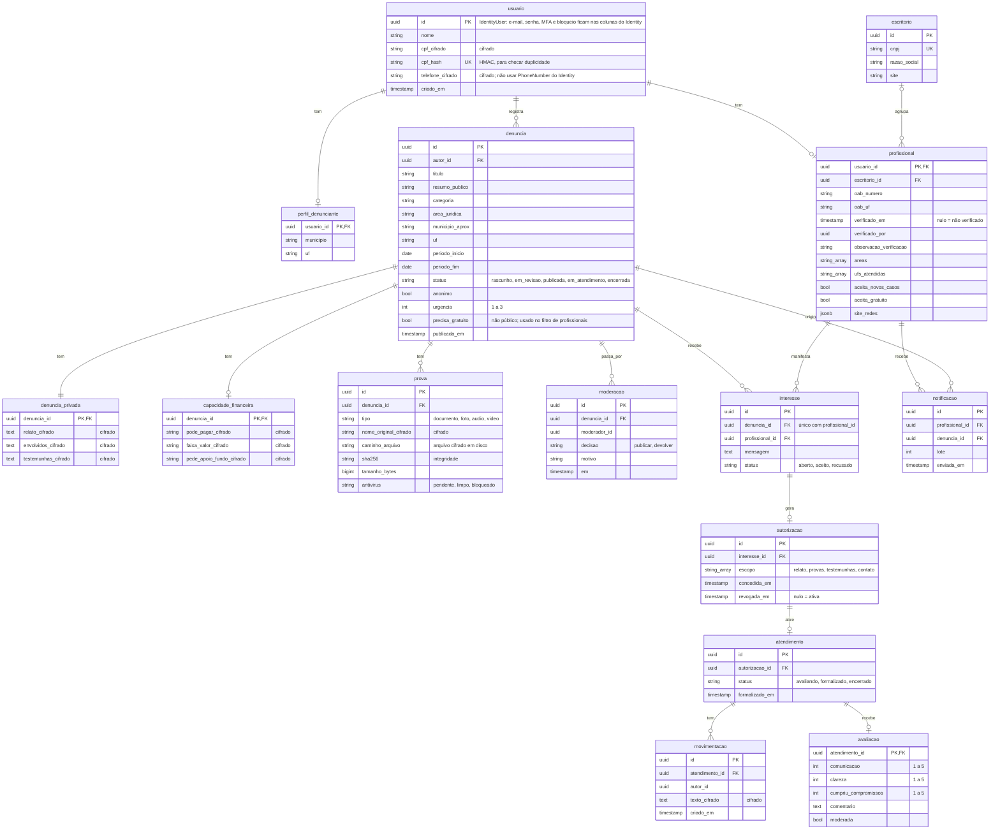

# 4 · Modelo de dados (PostgreSQL + EF Core)

Um schema por módulo, cada um com seu `DbContext`:

| Schema | Dono | Tabelas |
|---|---|---|
| `identidade` | módulo Identidade | tabelas do ASP.NET Core Identity, `perfil_denunciante`, `profissional`, `escritorio` |
| `casos` | módulo Casos | `denuncia`, `denuncia_privada`, `capacidade_financeira`, `prova`, `moderacao` |
| `assistencia` | módulo Assistencia | `interesse`, `autorizacao`, `atendimento`, `movimentacao`, `avaliacao`, `notificacao` |
| `auditoria` | Comum | `registro_auditoria` |
| `plataforma` | módulo Plataforma (Fase 3) | `doacao`, `lancamento`, `apoio_fundo` |

Campos com "cifrado" são criptografados na aplicação e ficam ilegíveis para quem acessar o banco ou um backup. Por isso **não dá para filtrar nem ordenar por eles em SQL**: tudo que precisa entrar num `WHERE` fica em coluna comum.

Tabelas fora do diagrama:

- **`auditoria.registro_auditoria`**: `id bigserial`, `ator_id uuid`, `acao`, `recurso`, `recurso_id`, `em`. Um trigger no banco recusa UPDATE e DELETE. Guarda só IDs, nunca dados pessoais.
- **Fase 3, schema `plataforma`**: `doacao` (valor, meio, id no gateway, data), `lancamento` (tipo receita/despesa/fundo, categoria, valor, data, comprovante) e `apoio_fundo` (denuncia_id, valor aprovado, critério, data da decisão).

Referências entre schemas (ex.: `denuncia.autor_id` → usuário) são só IDs, sem chave estrangeira no banco: cada módulo é dono das suas tabelas.
