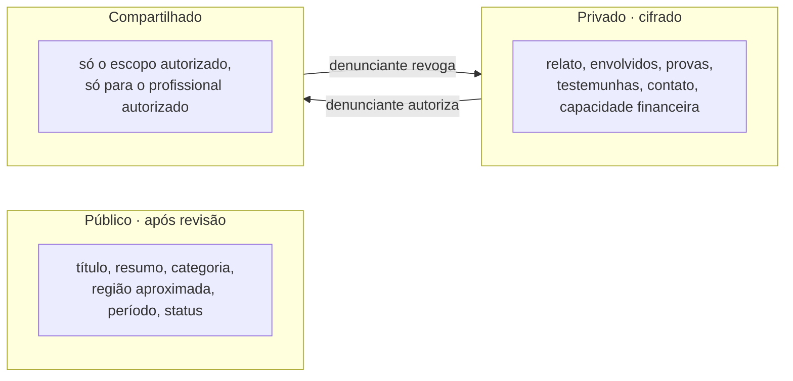

# 5 · Privacidade e permissões: quem vê o quê

A regra é aplicada na API (policies do ASP.NET Core por papel e por caso), nunca só escondida na tela do Angular.

| Dado | Visitante | Profissional verificado | Profissional autorizado | Denunciante (dono) | Moderação | Admin |
|---|---|---|---|---|---|---|
| **Resumo público** (título, categoria, região, período, status) | Vê, se publicado | Vê | Vê | Vê e edita | Revisa e edita | Vê |
| **Identidade** (nome, CPF) | Não | Não | Se no escopo | Vê e edita | Não | Com motivo registrado |
| **Contato** (telefone, e-mail) | Não | Não | Se no escopo | Vê e edita | Não | Com motivo registrado |
| **Relato e envolvidos** | Não | Não | Se no escopo | Vê e edita | Só para classificar | Não |
| **Provas** (arquivos) | Não | Não | Se no escopo | Envia e remove | Não | Não |
| **Testemunhas** | Não | Não | Se no escopo | Vê e edita | Não | Não |
| **Capacidade financeira** | Não | Só "precisa de gratuito" | Vê | Vê e edita | Vê | Comitê do fundo |
| **Registro de auditoria** | Não | Os próprios acessos | Os próprios acessos | Quem acessou seus dados | Não | Vê tudo |

## Camadas de dados

## Regras complementares

- **Download de provas:** link temporário de 5 minutos, gerado pela API só depois de checar a autorização ativa. Cada download vai para a auditoria.
- **Revogação:** encerra o acesso na hora. O que já foi baixado continua registrado. A exclusão respeita os prazos legais de guarda.
- **Profissional não verificado:** não acessa nada privado. Pode montar o perfil, mas só aparece na busca depois da checagem da OAB.
