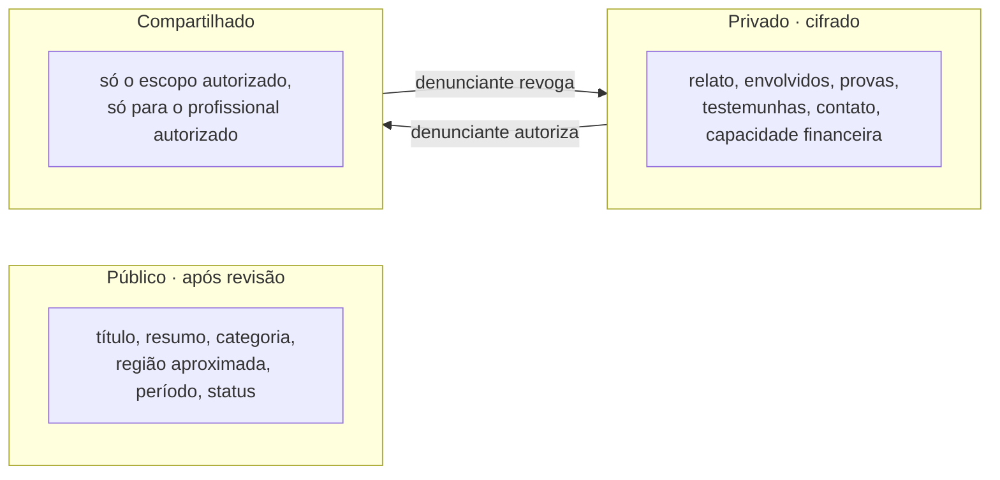

# 5 · Privacidade e permissões: quem vê o quê

A regra é aplicada na API (policies do ASP.NET Core por papel e por caso), nunca só escondida na tela do Angular.

| Dado | Visitante | Profissional verificado | Profissional autorizado | Denunciante (dono) | Moderação | Admin |
|---|---|---|---|---|---|---|
| **Resumo público** (título, categoria, região, período, status) | Vê, se publicado | Vê | Vê | Vê e edita | Revisa e edita | Vê |
| **Identidade** (nome, CPF) | Não | Não | Se no escopo | Vê e edita | Não | Com motivo registrado |
| **Contato** (telefone, e-mail) | Não | Não | Se no escopo | Vê e edita | Não | Com motivo registrado |
| **Relato e envolvidos** | Não | Não | Se no escopo | Vê e edita | Só para classificar | Não |
| **Provas** (arquivos) | Não | Não | Se no escopo | Envia, vê e remove | Não | Não |
| **Testemunhas** | Não | Não | Se no escopo | Vê e edita | Não | Não |
| **Capacidade financeira** | Não | Só "precisa de gratuito" | Vê | Vê e edita | Vê | Comitê do fundo |
| **Encaminhamentos · F1B** (dossiê, status, protocolo, comprovantes, respostas) | Não | Não | Se no escopo | Cria, autoriza e acompanha | Não | Só metadados: entidade, status, datas |
| **Catálogo de entidades · F1B** | Vê | Vê | Vê | Vê e sugere | Edita | Edita |
| **Manifestações** (fale conosco, pedidos, reportes) | Envia | Envia e vê as suas | Envia e vê as suas | Envia e vê as suas | Trata reportes e pedidos de catálogo | Trata as demais |
| **Registro de auditoria** | Não | Não | Não | Quem acessou seus dados | Não | Vê tudo |

## Camadas de dados

## Regras complementares

- **Download de provas:** o próprio endpoint da API checa a autorização ativa e devolve o arquivo decifrado. Não existe link público nem temporário. Cada download vai para a auditoria.
- **"Precisa de gratuito"** é a única informação financeira visível ao profissional verificado antes da autorização, para ele saber se pode ajudar.
- **Revogação:** encerra o acesso na hora. O que já foi baixado continua registrado. A exclusão respeita os prazos legais de guarda.
- **Encaminhamento:** só o dono do caso autoriza um envio, com a senha, destinatário por destinatário. Ninguém da equipe envia em nome do denunciante. A moderação revisa o caso antes do envio automático, mas não vê o dossiê. O escopo `encaminhamentos` é separado de `relato`: o dossiê contém o relato, então o profissional precisa dos dois para ler o dossiê inteiro.
- **Manifestações:** reclamações vão só para o admin, inclusive as que são sobre a moderação. Quem envia sem conta não acompanha pelo painel; recebe a resposta no e-mail, se informou um.
- **Profissional não verificado:** não acessa nada privado. Pode montar o perfil, mas só aparece na busca depois da checagem da OAB.
