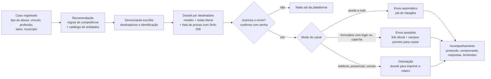
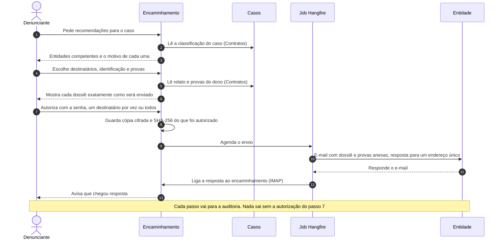

# 6 · Encaminhamento a órgãos e entidades

Módulo **Encaminhamento** (schema `encaminhamento`, Fase 1B). Ele ajuda o denunciante a levar o caso a quem tem competência para agir: órgãos de fiscalização, Ministério Público, conselhos profissionais, sindicatos, ouvidorias e canais de direitos humanos. Ele não substitui o advogado (módulo Assistencia): os dois caminhos podem andar juntos.

Três princípios guiam o módulo:

1. **Nada sai sem autorização explícita**, destinatário por destinatário, depois que o denunciante vê exatamente o que vai ser enviado.
2. **Nada é inventado.** O dossiê usa só o que o denunciante escreveu e anexou. O relato vai literal.
3. **Não se presume que um canal aceita e-mail ou automação.** Cada canal do catálogo diz como pode ser usado, com fonte oficial e data de conferência.

## Fluxo

## Envio automático por e-mail

## 1. Catálogo de entidades

Três tabelas guardam o catálogo (detalhes no [modelo de dados](04-modelo-de-dados.md)):

- **`entidade`**: quem recebe. Nome, sigla, tipo, natureza, esfera, abrangência territorial (UFs e municípios pelo código do IBGE), categorias profissionais atendidas, CNPJ, fonte oficial.
- **`canal`**: como recebe. Uma entidade pode ter vários canais (formulário, e-mail, telefone, presencial, correio). Cada canal diz se aceita denúncia anônima, se garante sigilo, se exige login gov.br, se tem captcha, se aceita anexos e qual o limite, se gera protocolo, e o **modo de envio** permitido.
- **`regra_competencia`**: quando a entidade é competente. Combina tipo de abuso, vínculo, setor e categoria profissional com um **grupo** de entidades (ex.: `mpt`, `mp_estadual`, `conselho_profissional`). Na hora da recomendação, o grupo vira a entidade que atende a UF, o município ou a profissão do caso.

A **natureza** separa o papel de cada entidade, como pedem as diretrizes:

| Natureza | O que faz | Exemplos |
|---|---|---|
| `fiscalizadora` | Fiscaliza e autua | Inspeção do Trabalho (MTE), conselhos profissionais |
| `investigativa_judicial` | Investiga e pode levar à Justiça | MPT, MPF, Ministério Público dos estados, MP Eleitoral |
| `representacao` | Defende a categoria e pode agir coletivamente | Sindicatos, federações, confederações |
| `acolhimento` | Recebe e repassa ao órgão competente | Disque 100, ouvidorias, Fala.BR |
| `assistencia_juridica` | Representa a pessoa em ação individual | Defensoria Pública (e os advogados da própria plataforma) |

### De onde vêm os dados

| Fonte | O que traz | Como entra |
|---|---|---|
| Arquivos CSV versionados em [`dados/catalogo/`](../../dados/catalogo/) | Órgãos federais e estaduais, conselhos, canais nacionais, regras de competência | `make importar-catalogo`, revisado por pull request. Toda linha tem `fonte_url` e `conferido_em` |
| Cadastro Nacional de Entidades Sindicais (CNES) do MTE | Sindicatos, federações e confederações com registro, base territorial e categoria | `make importar-cnes` a partir da planilha oficial (ver [fontes](#fontes)) |
| Painel da moderação | Correções, canais novos, sugestões dos usuários | Tela de edição, com auditoria |

Uma entidade ou canal sem `fonte_url` não é publicado. Canal importado do CNES começa no modo `orientacao`: o e-mail de contato do cadastro sindical não é necessariamente um canal de denúncia, então só vira `email` depois que a moderação confere.

### Manutenção

- **Job mensal** testa as URLs dos canais e marca as que falham. E-mails devolvidos (bounce) marcam o canal.
- Canal com `conferido_em` com mais de 12 meses entra na fila de revisão da moderação.
- O CNES é reimportado a cada 3 meses. A importação é idempotente (chave: código sindical ou CNPJ).
- Usuários podem sugerir uma entidade ou apontar um canal desatualizado. A sugestão vai para a moderação e nunca entra direto no catálogo.

## 2. Recomendação de destinatários

Consulta SQL sobre `regra_competencia` e `entidade`, sem IA. Entradas, todas em colunas comuns (não cifradas) do caso:

| Campo | Valores |
|---|---|
| `categoria` (tipo de abuso) | `assedio_eleitoral`, `perseguicao_politica`, `assedio_moral`, `assedio_sexual`, `discriminacao`, `irregularidade_trabalhista`, `trabalho_escravo`, `trabalho_infantil`, `desigualdade_salarial`, `saude_seguranca`, `etica_profissional`, `abuso_de_autoridade`, `violacao_direitos_humanos`, `outro` |
| `vinculo` | `clt`, `servidor_estatutario`, `temporario`, `terceirizado`, `estagiario`, `autonomo`, `sem_vinculo` |
| `setor` | `privado`, `publico_federal`, `publico_estadual`, `publico_municipal` |
| `categoria_profissional` | código da tabela `categoria_profissional` (ex.: `enfermagem`, `medicina`, `engenharia`) ou nulo |
| `uf`, `municipio_ibge` | onde os fatos aconteceram |
| `afeta_varias_pessoas` | se atinge um grupo de trabalhadores |

Saída: lista sem duplicatas, cada item com a entidade, o canal recomendado, a natureza e **o motivo em linguagem simples** ("O MPT investiga assédio eleitoral contra trabalhadores do setor privado"). A ordem segue as diretrizes: primeiro quem recebe denúncias e fiscaliza ou investiga, depois representação, depois acolhimento.

**Sindicatos** são o ponto fraco da automação: o CNES descreve a categoria em texto livre e há milhares de bases territoriais. A plataforma sugere os sindicatos da base territorial cuja categoria bate por busca de texto do PostgreSQL, marca como "possível" e pede confirmação: "O nome do sindicato costuma aparecer no contracheque ou na convenção coletiva".

### Regras iniciais

O arquivo [`regras-competencia.csv`](../../dados/catalogo/regras-competencia.csv) traz as regras de partida. As principais:

| Caso | Destinos recomendados |
|---|---|
| Assédio eleitoral, setor privado | MPT na UF · canal de assédio eleitoral do MTE · MP Eleitoral · sindicato da categoria |
| Assédio eleitoral, setor público | MP Eleitoral · Ministério Público (MPF se federal, MP do estado se estadual ou municipal) · ouvidoria do órgão · sindicato de servidores |
| Perseguição política, setor público | Ouvidoria ou corregedoria do órgão (Fala.BR, se federal) · Ministério Público · sindicato de servidores · Defensoria |
| Irregularidade trabalhista, CLT | Inspeção do Trabalho (MTE) · sindicato · MPT se afeta várias pessoas |
| Trabalho análogo ao escravo | Sistema Ipê do MTE (aceita anônimo) · MPT · MPF · Disque 100 |
| Trabalho infantil | Ipê Trabalho Infantil do MTE · MPT · Conselho Tutelar do município · Disque 100 |
| Desigualdade salarial entre mulheres e homens | Canal específico do MTE · MPT · sindicato |
| Assédio moral ou sexual, CLT | MPT · Inspeção do Trabalho · sindicato |
| Conduta antiética de profissional regulamentado | Conselho regional da profissão na UF |
| Violação de direitos humanos por agente público | Disque 100 · MPF ou MP do estado · Defensoria |
| Qualquer caso que peça reparação individual | Defensoria Pública ou advogado da plataforma (módulo Assistencia) |

Servidor estatutário não vai para o MPT: a Justiça do Trabalho não julga a relação estatutária. As regras são dados, não código: corrigir uma regra é editar o CSV ou o painel, sem deploy.

O denunciante só pode enviar automaticamente para entidades recomendadas para aquele caso. Se achar que falta alguma, sugere a entidade à moderação. Isso evita envio a órgão sem competência.

## 3. Dossiê por destinatário

Gerado a partir de um **modelo por tipo de entidade** (`modelo_documento`), sem IA:

1. Cabeçalho: destinatário, data e "Encaminhado pela plataforma a pedido do denunciante".
2. Identificação, conforme a escolha feita para este destinatário (ver abaixo).
3. Contra quem: empresa ou órgão, CNPJ e endereço, se informados.
4. **Relato literal**, como o denunciante escreveu.
5. Local e período dos fatos.
6. Lista de provas com nome, tipo, data de envio e SHA-256.
7. Pedido padrão do tipo de entidade (ex.: "Solicito apuração e fiscalização").
8. Declaração do denunciante de que os fatos são verdadeiros pelo que sabe.

"Adequado a cada destinatário" significa: o modelo muda o cabeçalho e o pedido, e um **checklist de requisitos do canal** aponta o que falta antes do envio. Exemplo: a denúncia trabalhista geral do MTE pede os dados do empregador. A plataforma pergunta o que falta. Ela não preenche nada sozinha.

O dossiê é HTML com CSS de impressão (o PDF sai pelo "Imprimir" do navegador). No e-mail, o mesmo modelo gera texto puro.

## 4. Identificação e sigilo

Para cada destinatário, o denunciante escolhe uma opção, limitada ao que o canal aceita:

| Opção | O que vai no dossiê | Quando aparece |
|---|---|---|
| `identificado` | Nome, CPF e contato | Sempre |
| `sigiloso` | Nome, CPF e contato, com pedido expresso de sigilo | Se `canal.aceita_sigilo` |
| `anonimo` | Nenhum dado pessoal. O e-mail sai da plataforma | Se `canal.aceita_anonimo` |

Avisos obrigatórios na tela de escolha:

- Uma denúncia anônima pode não ter protocolo nem permitir complemento. O Fala.BR, por exemplo, registra a denúncia anônima como "comunicação", sem acompanhamento.
- Detalhes do relato e metadados de fotos (como a localização) podem identificar a pessoa mesmo no modo anônimo. Revise antes de enviar.
- Opinião política é dado pessoal sensível pela LGPD (art. 5º, II). O consentimento para o envio é específico e destacado, por destinatário (art. 11, I).

## 5. Modos de envio

| Modo | Quando | O que a plataforma faz | O que o denunciante faz |
|---|---|---|---|
| `email` | O canal aceita denúncia por e-mail, conferido pela moderação | Envia do endereço da plataforma, com as provas anexas até o limite do canal e um endereço de resposta único | Autoriza |
| `assistido` | Formulário oficial com login gov.br, captcha ou sem integração | Abre o link oficial e mostra cada campo do formulário com o texto pronto para copiar e as provas para baixar | Preenche e envia no site oficial, depois registra o protocolo e anexa o comprovante |
| `orientacao` | Telefone, WhatsApp, presencial ou correio | Mostra o roteiro, o horário e o dossiê para imprimir | Faz o contato e registra o protocolo |
| `api` | Só se uma entidade oferecer API para terceiros | Implementação nova de `ICanalEnvio` | Autoriza |

**O que a plataforma não faz**, e por quê:

- **Não preenche formulários oficiais com robô.** A maioria exige login gov.br da própria pessoa ou tem captcha. Entrar com a conta gov.br de alguém ou contornar captcha não é aceitável.
- **Não usa a API do Fala.BR.** Ela existe, mas é para os órgãos integrarem os próprios sistemas, com credencial de órgão.
- **Não manda link para provas.** Provas vão anexas ao e-mail (regra 5 do [AGENTS.md](../../AGENTS.md)). Se passarem do limite, o dossiê lista as que ficaram de fora com o SHA-256, disponíveis a pedido.

### Envio para vários destinatários

- O denunciante marca vários destinatários e revisa um dossiê por destinatário. Pode autorizar um por um ou todos de uma vez, com uma única confirmação de senha.
- Um encaminhamento ativo por par caso e entidade (índice único). Reenviar exige cancelar o anterior com motivo.
- Limites configuráveis: envios por usuário por dia e e-mails da plataforma por entidade por dia.
- **Envio automático exige caso revisado pela moderação** (status `publicada` ou `aprovada`). Isso protege as entidades de spam e a plataforma de uso abusivo. O modo assistido não exige revisão, porque quem envia é o próprio denunciante.
- O job de envio é idempotente: o `Message-ID` do e-mail é derivado do ID do encaminhamento, então uma nova tentativa não duplica o envio.

## 6. Acompanhamento

Cada encaminhamento tem uma linha do tempo (`evento_encaminhamento`):

| Status | Significado |
|---|---|
| `rascunho` | Destinatário escolhido, dossiê em revisão |
| `autorizado` | Denunciante autorizou. Cópia e SHA-256 do dossiê guardados |
| `enviado` | E-mail aceito pelo servidor SMTP, ou denunciante confirmou o envio assistido |
| `falha` | E-mail recusado ou devolvido. O denunciante é avisado |
| `protocolado` | Protocolo registrado, com comprovante opcional |
| `respondido` | Chegou resposta da entidade |
| `encerrado` | O denunciante ou a entidade encerrou |
| `cancelado` | Cancelado antes do envio, ou anulado para reenvio |

- **Respostas por e-mail** chegam num endereço único por encaminhamento (`resposta+<token>@dominio`). Um job lê a caixa por IMAP e liga a resposta ao encaminhamento, com o texto cifrado.
- **Protocolo e comprovante** do modo assistido são registrados pelo denunciante. O comprovante é guardado como as provas: cifrado, verificado pelo antivírus e entregue só pelo endpoint autorizado.
- **Lembretes:** se a entidade não responder no prazo médio do canal (`prazo_resposta_dias`), o denunciante recebe um lembrete com o próximo passo (consultar o protocolo, procurar a ouvidoria da entidade).

## Página pública "Onde denunciar"

Visitante sem conta responde às mesmas perguntas (tipo de abuso, vínculo, setor, profissão, UF) e vê as entidades e os canais recomendados. **Nada é gravado**: o cálculo roda na API sem guardar a consulta, e as respostas ficam só no navegador. Serve para quem não quer criar conta e para divulgar os canais oficiais.

## Integração com os outros módulos

- **Casos** expõe em `Contratos/` a leitura da classificação e, só para o dono do caso, do relato e das provas.
- **Identidade** expõe nome, CPF e contato do denunciante, usados só quando a identificação escolhida não é `anonimo`.
- **Assistencia:** o profissional autorizado com o escopo `encaminhamentos` vê a lista de encaminhamentos, os protocolos e as respostas.
- **Comum:** auditoria em toda autorização, envio, leitura de resposta e edição do catálogo.

## Fontes

Conferidas em 03/11/2026. Os detalhes de cada canal ficam no catálogo, com fonte por linha.

- [Realizar denúncia trabalhista (gov.br)](https://www.gov.br/pt-br/servicos/realizar-denuncia-trabalhista): a denúncia geral exige login gov.br e não pode ser anônima. O canal de trabalho escravo (Ipê) não exige identificação.
- [Canal de assédio eleitoral do MTE](https://assedioeleitoral.trabalho.gov.br/): nome opcional, captcha, até 5 anexos.
- [MPT · Denuncie](https://mpt.mp.br/pgt/servicos/servico-denuncie): o formulário é de cada Procuradoria Regional (`peticionamento.prtN.mpt.mp.br`).
- [MPF · Informar irregularidade ou fato ilícito](https://www.mpf.mp.br/servicos/denuncias/representacao): online com conta gov.br. Anônimo só por carta.
- [API do Fala.BR (Wiki CGU)](https://wiki.cgu.gov.br/index.php/3.1_Como_utilizar_a_API_do_Fala.br_(Me-Ouv)): API para órgãos integrarem seus sistemas.
- [Disque 100](https://www.gov.br/pt-br/servicos/denunciar-violacao-de-direitos-humanos): telefone, WhatsApp, Telegram e chat. Aceita anônimo e gera protocolo.
- [Entidades sindicais registradas (MTE)](https://www.gov.br/trabalho-e-emprego/pt-br/servicos/sindicatos/cadastro-de-entidades/entidade-sindical-registrada) e [CNES](https://cnes.trabalho.gov.br/app/).
